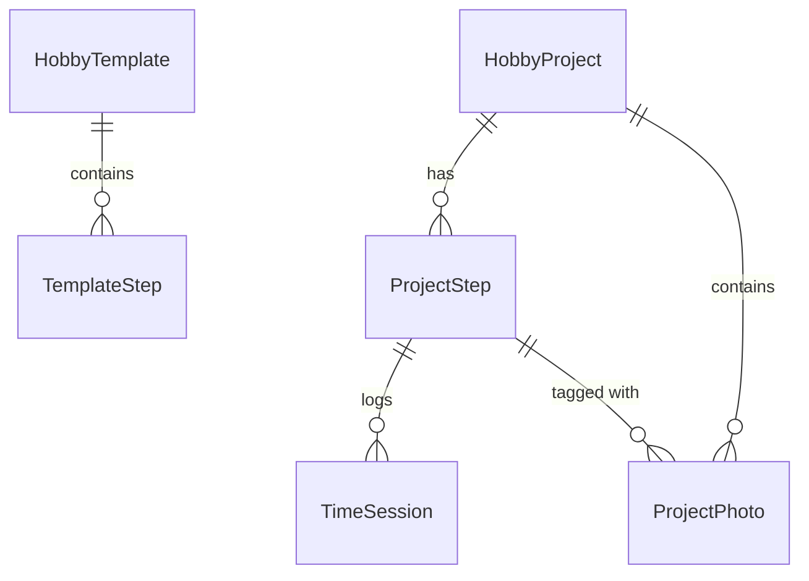

# Product Requirements Document (PRD)
## Project: HobbyCraft - Multi-Stage Hobby Time Tracker

*Document Status: Approved Specification for Xcode AI Implementation*  
*Target Platforms: iOS 17.0+, iPadOS 17.0+*  
*Architecture: SwiftUI + SwiftData with CloudKit Sync + ActivityKit (Live Activities / Dynamic Island)*  

---

## 1. Executive Summary & Vision

### 1.1 Objective
**HobbyCraft** is an iOS & iPadOS application designed for hobbyists, makers, craftspeople, and model builders (e.g., 3D printing enthusiasts, miniature painters, woodworkers, cosplayers). The app enables users to:
1. Organize multi-stage creative projects into logical phases/steps (e.g., *CAD Design & Slicing* ➔ *3D Printing* ➔ *Sanding/Prep* ➔ *Priming & Painting* ➔ *Final Assembly*).
2. Accurately measure and log time spent on each specific step via both a **Live Stopwatch Timer** (with Lock Screen Live Activity & Dynamic Island) and **Manual Duration Entry**.
3. Document progress visually through an integrated **Progress Photo Gallery** tied to projects and steps.
4. Seamlessly synchronize all project data and photos across all the user's Apple devices via **iCloud (SwiftData with CloudKit backing)** with full offline capability.

---

## 2. Technical Stack & Architecture

| Layer | Technology | Details & Justification |
| :--- | :--- | :--- |
| **Framework** | SwiftUI (iOS 17+) | Modern declarative UI, `@Observable` macro, native navigation splits for iPad and stacks for iPhone. |
| **Persistence** | SwiftData (`@Model`) | Native Swift object graph persistence replacing CoreData. |
| **Cloud Sync** | Apple CloudKit (Private Database) | Automatic multi-device sync and backup via SwiftData's CloudKit integration. |
| **Timer & Dynamic Island** | ActivityKit & WidgetKit | Background time tracking with real-time lock screen Live Activities and Dynamic Island widgets. |
| **Media Handling** | PhotosUI (`PhotosPicker`) | Native SwiftUI photo picking; images compressed and stored via SwiftData `@Attribute(.externalStorage)`. |
| **Concurrency** | Swift Concurrency (`async`/`await`, Actors) | Modern Swift concurrency, avoiding Combine. |
| **Testing** | Swift Testing framework (`import Testing`, `@Test`) | Modern Apple testing suite for unit tests; XCUITest for UI flows. |

---

## 3. Data Model Specification (SwiftData)

To support CloudKit synchronization with SwiftData, all entity relationships **must be optional**, attributes should provide default values, and schema requirements must be strictly adhered to.



### 3.1 `HobbyTemplate` & `TemplateStep`
Predefined and user-customizable project workflows.
- **`HobbyTemplate`**
  - `id: UUID` (Default: `UUID()`)
  - `name: String` (e.g., "3D Printing", "Miniature Painting", "Woodworking", "Custom")
  - `iconName: String` (SF Symbol name, e.g., `"cube.fill"`, `"paintbrush.fill"`)
  - `colorHex: String` (Accent color)
  - `isBuiltIn: Bool` (true for factory defaults)
  - `steps: [TemplateStep]?` (Relationship to steps, delete rule: `.cascade`, sorted by orderIndex)

- **`TemplateStep`**
  - `id: UUID` (Default: `UUID()`)
  - `name: String` (e.g., "Sanding & Cleanup")
  - `orderIndex: Int`
  - `defaultEstimatedMinutes: Int?` (Optional estimated baseline)
  - `template: HobbyTemplate?` (Inverse relationship)

### 3.2 `HobbyProject`
The core entity representing a single hobby craft or build.
- `id: UUID` (Default: `UUID()`)
  - `title: String`
  - `projectDescription: String` (Default: `""`)
  - `categoryName: String` (e.g., "3D Printing")
  - `iconName: String` (SF Symbol)
  - `colorHex: String`
  - `statusRawValue: String` (Values: `"planning"`, `"inProgress"`, `"paused"`, `"completed"`)
  - `createdDate: Date` (Default: `Date.now`)
  - `lastModifiedDate: Date` (Default: `Date.now`)
  - `targetDueDate: Date?`
  - `steps: [ProjectStep]?` (Relationship to `ProjectStep`, delete rule: `.cascade`, sorted by `orderIndex`)
  - `photos: [ProjectPhoto]?` (Relationship to `ProjectPhoto`, delete rule: `.cascade`)
  - *Computed Properties*:
    - `totalDuration: TimeInterval` (Sum of all completed sessions across all steps)
    - `currentStatus: ProjectStatus` (Enum mapped to `statusRawValue`)
    - `progressPercentage: Double` (Ratio of completed steps vs. total steps)

### 3.3 `ProjectStep`
A discrete phase within a project.
- `id: UUID` (Default: `UUID()`)
  - `name: String` (e.g., "Slicing", "Printing", "Sanding", "Painting")
  - `orderIndex: Int`
  - `isCompleted: Bool` (Default: `false`)
  - `completedDate: Date?`
  - `notes: String` (Default: `""`)
  - `project: HobbyProject?` (Inverse relationship)
  - `sessions: [TimeSession]?` (Relationship to `TimeSession`, delete rule: `.cascade`)
  - `photos: [ProjectPhoto]?` (Relationship to `ProjectPhoto`)
  - *Computed Properties*:
    - `totalStepDuration: TimeInterval` (Sum of all step sessions)

### 3.4 `TimeSession`
An individual work session representing time spent on a step.
- `id: UUID` (Default: `UUID()`)
  - `startDate: Date`
  - `endDate: Date`
  - `duration: TimeInterval` (Computed as `endDate.timeIntervalSince(startDate)` or manual entry value)
  - `isManualEntry: Bool` (Default: `false`)
  - `notes: String` (Default: `""`)
  - `step: ProjectStep?` (Inverse relationship)

### 3.5 `ProjectPhoto`
Visual progress updates captured along the way.
- `id: UUID` (Default: `UUID()`)
  - `timestamp: Date` (Default: `Date.now`)
  - `caption: String` (Default: `""`)
  - `@Attribute(.externalStorage) photoData: Data?` (Optimized binary image data)
  - `thumbnailData: Data?` (Low-res cached thumbnail for high-performance gallery grids)
  - `project: HobbyProject?` (Inverse relationship)
  - `step: ProjectStep?` (Optional link to a specific step, e.g., sanding before/after)

---

## 4. Feature Requirements & Functional Details

### 4.1 Project & Workflow Creation
1. **New Project Flow**:
   - Title input with category/template selection.
   - Choosing a template (e.g., "3D Printing") automatically instantiates all default steps.
   - User can add custom steps, rename steps, or reorder them via drag-and-drop (`onMove`).
   - Project status selector: Planning, In Progress, Paused, Completed.
2. **Template Library**:
   - **Factory Defaults**:
     - *3D Printing*: 1. CAD & Slicing ➔ 2. Machine Printing ➔ 3. Support Removal & Wash ➔ 4. Sanding & Curing ➔ 5. Priming & Painting ➔ 6. Clear Coat & Assembly.
     - *Miniature & Model Painting*: 1. Assembly & Gap Filling ➔ 2. Priming ➔ 3. Basecoating ➔ 4. Shading & Washing ➔ 5. Layering & Highlighting ➔ 6. Basing & Varnishing.
     - *Woodworking*: 1. Design & Milling ➔ 2. Joinery & Cutting ➔ 3. Dry Fit ➔ 4. Glue Up ➔ 5. Sanding ➔ 6. Finishing.
     - *Custom / Blank*: Allows custom initial step definitions.
   - Ability for user to save any project's steps as a custom template for future builds.

### 4.2 Time Tracking Engine

#### A. Live Stopwatch Timer
- Start, Pause, Resume, and Stop controls accessible directly from the Project Detail screen on any active step.
- Only **one** active timer may run globally across the app at any given time.
- **Background Accuracy**:
  - The timer must record the `startDate: Date` and cumulative pauses rather than ticking an internal counter. When reopened or resumed from background, time delta is accurately derived from system clock timestamps.
- **Save Session Modal**:
  - Tapping "Stop & Save" triggers a confirmation sheet displaying:
    - Step name & Project name
    - Total elapsed session duration (`HH:MM:SS`)
    - Work session notes field (e.g., "Finished 400-grit wet sanding, switched to 800-grit")
    - Option to automatically mark the step as "Completed" upon saving
  - Tapping "Discard" clears the active timer with a confirmation alert.

#### B. Manual Time Entry Sheet
- Available via a "+ Log Time" button on each step.
- Inputs:
  - Date and time picker (defaults to today).
  - Time duration picker (wheel or stepper for Hours and Minutes).
  - Optional session notes / observations.

#### C. Live Activities & Dynamic Island (`ActivityKit`)
- When a timer starts:
  - An `Activity<HobbyTimerAttributes>` is requested.
  - **Dynamic Island Compact**: Displays hobby icon + running timer (`Text(timerInterval: ..., countsDown: false)`).
  - **Dynamic Island Expanded**: Displays Project Title, Step Name, Elapsed Timer, and Pause/Stop buttons.
  - **Lock Screen / StandBy Banner**: Displays Project icon, Project Title, current step, live incrementing timer, and quick Stop action.
- Tapping the Dynamic Island or Live Activity returns the user directly to the active project in the app via deep link URL (`hobbycraft://project/{id}`).

### 4.3 Visual Progress Gallery
- Built with `PhotosPicker` from `PhotosUI`.
- Integrated directly in the Project Detail view (accessible as a dedicated tab/section).
- Each photo records:
  - Full image (compressed JPEG) stored with `@Attribute(.externalStorage)`.
  - Date taken.
  - Associated step (e.g., tagged to "Priming & Painting").
  - Caption / Notes.
- Tap-to-zoom full screen image viewer (`TabView` with paging or interactive magnification).

### 4.4 Dashboard & Organization
- **Project List View**:
  - Segmented/Filter bar: All, Active, Completed.
  - Summary cards showing:
    - Project Title & Category icon.
    - Total accumulated hours & minutes.
    - Current active step indicator.
    - Progress ring or bar (e.g., 3/5 steps completed).
    - Status badge (In Progress, Paused, Completed).
    - Thumbnail of the most recent progress photo.
- **Search & Filter**:
  - Search by project title or category name.

### 4.5 iCloud Synchronization & Offline Persistence
- Uses SwiftData's native CloudKit container integration:
  ```swift
  let config = ModelConfiguration(
      "HobbyCraftStore",
      cloudKitDatabase: .private("iCloud.com.yourdomain.HobbyCraft")
  )
  ```
- All data models comply with CloudKit requirements:
  - All relationships are optional (`ProjectStep?`, `[TimeSession]?`).
  - No unsupported unique constraints on synced attributes.
  - Non-optional properties have default fallback values.
- Seamless offline support: Changes are persisted to the local SQLite backing store immediately and uploaded automatically when connectivity resumes.

---

## 5. UI/UX Design System & Layout Guidelines

- **Style**: Modern iOS 17+ HIG (Human Interface Guidelines), clean rounded cards, system standard typography, SF Symbols 5.
- **Color Coding**: Dynamic palette based on hobby category (e.g., Blue for 3D Printing, Orange for Woodworking, Purple for Miniature Painting).
- **iPad Support**: Responsive `NavigationSplitView` with a persistent sidebar showing Projects and Templates, and detail view showing the project workspace.
- **Haptic Feedback**: Standard tactile haptics (`UIImpactFeedbackGenerator`) when starting/stopping timers and completing steps.

---

## 6. Implementation Task Checklist for Xcode AI Agent

To build this app in Xcode, follow this structured roadmap:

### Phase 1: Project Setup & Capabilities
- [ ] Ensure iOS 17.0+ deployment target.
- [ ] Enable **iCloud** capability in target entitlements (CloudKit service enabled, custom container configured).
- [ ] Enable **Background Modes** (Remote notifications for CloudKit synchronization).
- [ ] Add **Widget Extension** target with `Live Activity` support.

### Phase 2: SwiftData Schema
- [ ] Implement `HobbyProject.swift`, `ProjectStep.swift`, `TimeSession.swift`, `ProjectPhoto.swift`, `HobbyTemplate.swift`, and `TemplateStep.swift`.
- [ ] Configure `ModelContainer` in `App.swift` with CloudKit backing.
- [ ] Create a `DataPreviewContainer` for fast, crash-free SwiftUI Canvas previews.

### Phase 3: Time Tracking Service & ActivityKit
- [ ] Implement `@Observable class TimerManager`: Handles live start/pause/resume/stop, calculates elapsed time, persists state to `UserDefaults` or SwiftData in case of app termination.
- [ ] Create `HobbyTimerActivityWidget` with `ActivityAttributes` for Dynamic Island and Lock Screen widgets.
- [ ] Wire background deep linking to resume active session on tap.

### Phase 4: Core SwiftUI Views
- [ ] `ProjectDashboardView`: Grid/List of projects with search, filter tabs, and "New Project" button.
- [ ] `ProjectDetailView`: Master project view with Step list, Live Timer card, and Photo gallery.
- [ ] `StepRowView`: Interactive row with direct "Play" timer button, step completion toggle, and time summary.
- [ ] `ManualTimeEntrySheet`: Form to record past work duration.
- [ ] `SaveSessionSheet`: Sheet to review time, add notes, and finish a session.
- [ ] `NewProjectView`: Creation wizard with template selection.
- [ ] `PhotoGalleryView` & `PhotoDetailView`: Progress photo picker, grid, and full-screen viewer.

### Phase 5: Testing & Polishing
- [ ] Write unit tests using the `Testing` framework to verify duration calculations and step aggregations.
- [ ] Verify CloudKit synchronization across multiple simulators or devices.
